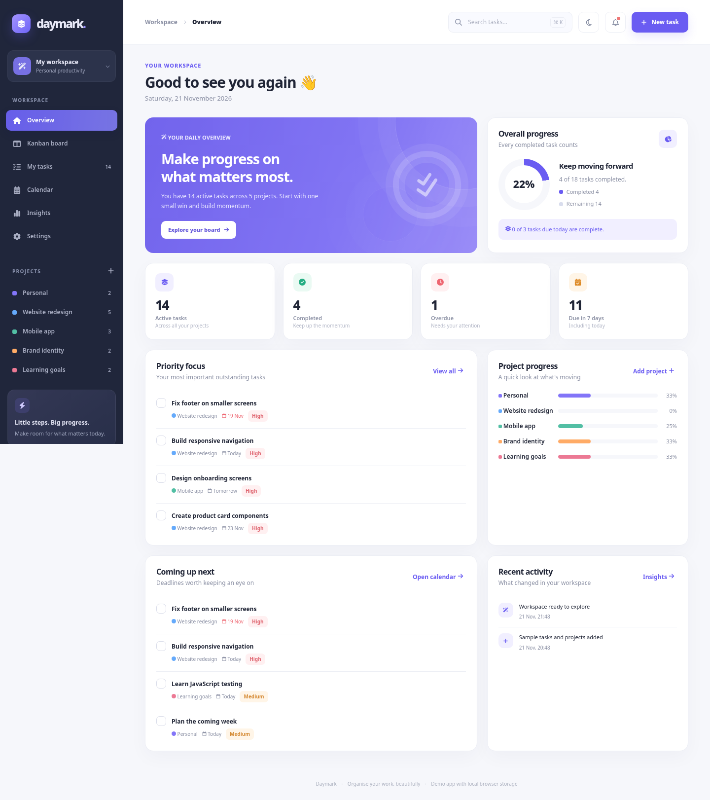
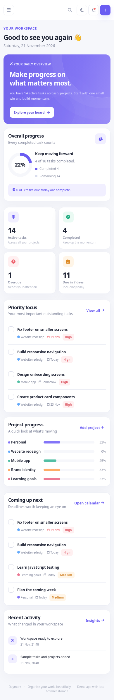

# Daymark — Your work, in focus

A responsive, local-first task management dashboard with a Kanban board, project organisation, calendar, priority tracking, and productivity insights.

**Suggested GitHub repository name:** `daymark-task-management-dashboard`



## What the application does

- **Dashboard:** live summary of active/completed/overdue tasks, deadlines, priorities, and project progress.
- **Kanban board:** To do → In progress → In review → Done. Drag cards on desktop; use the status selector on mobile.
- **My tasks:** editable task list with priority, status, due date, and project details.
- **Calendar:** interactive monthly calendar and daily agenda, with tasks linked to their deadlines.
- **Insights:** automatically calculated completion rate, weekly completion chart, status distribution, workload by project, and priority breakdown.
- **Task management:** add, edit, complete, reopen, and delete tasks; assign them to projects, set priority and estimated time, attach tags, add checklists, and configure recurring tasks (daily, weekly, monthly).
- **Projects:** create colour-coded projects; safely delete projects by moving their tasks to Personal.
- **Search & filters:** search title, description, tags, and project name; filter by priority or project and sort by due date, priority, recent creation, or title.
- **Persistence & backup:** tasks are saved automatically to `localStorage`; import/export a JSON backup; restore demonstration data or clear the workspace.
- **Polish & accessibility:** dark mode, mobile navigation, keyboard shortcuts, semantic landmarks, descriptive controls, reduced-motion support, and confirmation before destructive changes.

The project opens with example tasks so visitors can explore its features immediately. Example deadlines are generated relative to the current date.

## Technologies

| Technology | Purpose |
|---|---|
| HTML5 | Semantic application structure and forms |
| CSS3 | Responsive layout, design system, dark mode, animations |
| Vanilla JavaScript | State management, rendering, interactions, calendar, validation, analytics |
| Browser localStorage | Per-browser task persistence |
| Font Awesome Free SVG icons | Icon artwork bundled in `icons.js` under CC BY 4.0 (attributed in `CREDITS.md`) |
| System font stack | Uses Manrope/DM Sans when installed, otherwise native system fonts; no font downloads required |

There is **no build step** and no npm dependency required to use this version.

## Run locally

1. Download the ZIP and **extract** its contents.
2. Keep the files together in the same folder.
3. Double-click **`index.html`**.
4. Explore the sample tasks or go to **Settings → Clear workspace** to start fresh.

For a local development server, open the folder in VS Code and use a local server extension, or run:

```bash
python3 -m http.server 5500
```

Then visit `http://localhost:5500`.

## Publish on GitHub Pages

All project files are at the **repository root**: no folders need to be uploaded.

1. Create a public GitHub repository named `daymark-task-management-dashboard`.
2. Select **Add file → Upload files**.
3. Upload the **extracted files**, not the ZIP.
4. Commit the files to the default branch.
5. Open **Settings → Pages**. Under *Build and deployment*, select **Deploy from a branch**.
6. Choose your default branch and `/ (root)`, then save.
7. Open the GitHub Pages URL once deployment completes.

GitHub Pages hosts this static client-side application. Each browser keeps **its own independent data**; changes are not synced between devices or visitors.

## Keyboard shortcuts

- `Ctrl + K` or `⌘ + K`: focus search.
- `N`: create a new task (when not typing in a field).
- `Esc`: close a dialog or mobile navigation.

## Files

| File | Purpose |
|---|---|
| `index.html` | Application entry point and semantic shell |
| `styles.css` | Complete custom design system and responsive styles |
| `app.js` | State, example data, views, CRUD, analytics, local backup |
| `icons.js` | Bundled, attributed Font Awesome Free SVG icon paths |
| `favicon.svg` | Custom Daymark mark |
| `daymark-desktop-preview.png` | Desktop screenshot |
| `daymark-mobile-preview.png` | Mobile screenshot |
| `CREDITS.md` | Third-party attributions |

### Responsive screenshots



## Important limitations

This is a **front-end portfolio demo**, not a multi-user production service. It does not have a server, user accounts, email reminders, real push notifications, team collaboration, cloud synchronisation, or permissions. The notification icon displays deadlines **inside the app**. Browser storage may be cleared, limited or unavailable; use the JSON export feature to make backups.

## Suggested next improvements

- Add a Django REST API, PostgreSQL database, and optional sign-in.
- Add task comments, activity logs per task, and actual team assignment.
- Add server-side reminders and notifications.
- Add automated unit and end-to-end tests, including accessibility checks.

## Academic integrity

This project was initially generated and refined with **ChatGPT assistance**. If you submit it as assessed work or represent it in an application, review the code, test it yourself, explain your own contributions accurately, and acknowledge AI use in the format required by your university.
